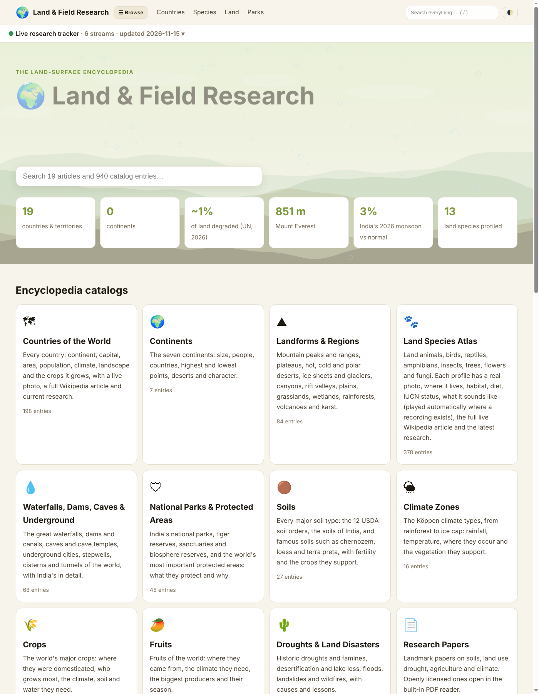
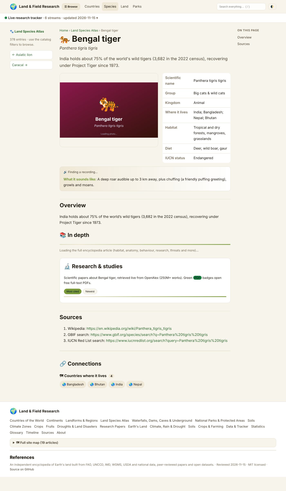
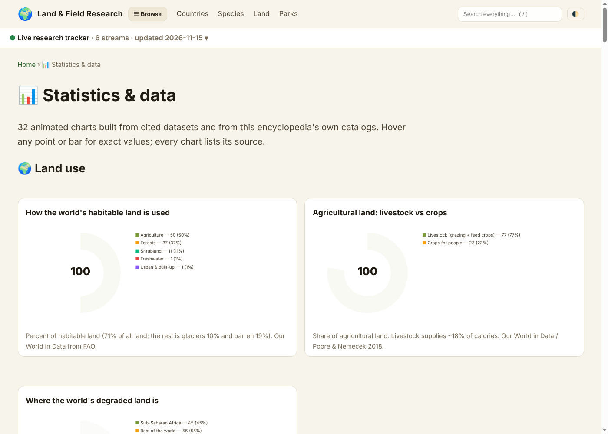

<div align="center">

# 🌍 Land & Field Research

**An in-depth, sourced encyclopedia of Earth's land.** It covers every country and continent; mountain tops, plateaus, deserts, snow and ice; soils, rainfall and drought; land species; waterfalls, dams, caves and underground cities; national parks; and the crops and fruits each region grows.

[](https://shiroonigami23-ui.github.io/Land-surface-research/)
[](https://github.com/shiroonigami23-ui/Land-surface-research/actions)
[](LICENSE)




</div>

## What's inside

| Catalog | Entries | What each page has |
|---|---|---|
| 🗺 Countries of the World | 198 | Continent, capital, area, population, climate, landscape, crops; live photo; full Wikipedia article; research papers; linked parks, landforms and species |
| 🧭 Regions of the World | 99 | Climate, rainfall, temperature, soils, landscape, vegetation, wildlife, crops, people and threats, linked to matching countries, climates, soils, landforms, species and crops |
| 🌍 Continents | 7 | Area, people, highest and lowest points, deserts |
| ⛰ Landforms & Regions | 84 | Peaks, ranges, plateaus, hot, cold and polar deserts, ice sheets, glaciers, permafrost, canyons, rift valleys, plains, grasslands, wetlands, rainforests, volcanoes, karst |
| 🐾 Land Species Atlas | 2,526 | Mammals, birds, reptiles, amphibians, insects, trees, flowers and fungi; IUCN status; **what it sounds like**, with the recording **auto-played** from Wikimedia Commons where one exists |
| 💧 Waterfalls, Dams, Caves & Underground | 68 | Angel Falls to Jog Falls, Three Gorges to Kallanai, Son Doong to Ajanta, Derinkuyu to Chand Baori |
| 🛡 National Parks & Protected Areas | 48 | India's tiger reserves, national parks and sanctuaries; world parks |
| 🟤 Soils | 27 | 12 USDA orders, 8 Indian soil groups, chernozem, loess, terra preta |
| 🌦 Climate Zones | 16 | Köppen types with rainfall and vegetation |
| 🌾 Crops · 🥭 Fruits | 38 · 37 | Origin, top producers, climate, soil, water needs |
| 🌵 Droughts & Land Disasters | 23 | Dust Bowl, Great Famine, Sahel, Aral Sea, 2026 monsoon deficit… |
| 📄 Research Papers | 16 | Openly licensed PDFs mirrored and readable in the built-in reader |

There are also **20 long-form articles** in five sections: Earth's Land, Climate, Rain & Drought, Soils, Crops & Farming, and Data & Tracker. The site includes **animated statistics**, a **live research tracker** on every page, a glossary, a timeline and a full bibliography.

<p align="center"> </p>

## Live tracker (15 Nov 2026)

- 🌳 **Amazon deforestation**: 3,335 km² cleared in Aug 2025–Jul 2026, down 41.8% and the lowest since 1988 (INPE PRODES).
- 🌧 **India monsoon 2026**: 759.4 mm, 87% of normal (IMD).
- 🏔 **Glaciers**: 408 ± 132 Gt lost in 2025; all 19 regions shrank for the fourth year running (WGMS, Copernicus).
- 🏜 **UNCCD COP17** in Mongolia: up to 40% of land is degraded.

## How it works

```
site_src/            Markdown articles + JSON catalogs + site.json config + stats.json charts
  data/src/          compact source files and builders (cat.py, land_species.py, papers.py)
scripts/build_site.py  static-site generator (Markdown + Jinja2) -> index.html and wiki/
scripts/charts.py      animated SVG chart library
scripts/check_links.py link and image checker
scripts/fetch_papers.py downloads openly licensed paper PDFs (runs in GitHub Actions)
```

Every catalog page also loads, live in the visitor's browser:
- a real photo from Wikimedia Commons;
- the full Wikipedia article, split into collapsible sections;
- a sound recording, where one exists;
- the most-cited and newest papers from OpenAlex.

### Build locally

```bash
pip install -r scripts/requirements.txt
python scripts/build_site.py      # SKIP_PDF=1 to skip PDF export
python scripts/check_links.py
python -m http.server              # open http://localhost:8000
```

### Missing photos

`prompts.md` lists a ready-made Nano Banana prompt for every catalog entry. The site's **Photo status** page (`wiki/photo-status.html`) checks which entries have no openly licensed photo. Generate only those, save each image to the path shown, and rebuild.

## Workflows

- **validate.yml**: builds the site and checks every link on each push.
- **fetch-papers.yml**: mirrors openly licensed PDFs into `assets/papers/`.

## Sources

FAO, UNCCD, IPCC, IMD, INPE, WGMS, Copernicus, ICAR, NCERT, USGS, IUCN, GBIF, Protected Planet and peer-reviewed papers. Each article lists its sources, and [the bibliography page](https://shiroonigami23-ui.github.io/Land-surface-research/wiki/sources.html) collects them all.

## License

[MIT](LICENSE) © 2026 Aryan Singh Chandel. Photos, sounds and article text loaded from Wikimedia projects remain under their own licences (CC BY-SA and others) and are credited on each page.
